# 21 исходный слайд Альфа-Банка

Две секции из предоставленного файла Figma. Страницы 1–14 относятся к стратегии Нейроофиса, 15–21 — к отчёту КРБ. В каталоге сохранён порядок слева направо на холсте. Подписи фреймов и номера внутри макетов принадлежат исходнику и могут отличаться от номера страницы каталога.

[Как применить оригинал к новым данным](REUSE.md) · [Оригинальные слои Figma](originals.fig) · [PDF, 21 страница](originals.pdf) · [Редактируемый PowerPoint](originals.pptx) · [14 компонентов исходника](components/INDEX.md) · [Указатель для программного выбора](catalog.json)

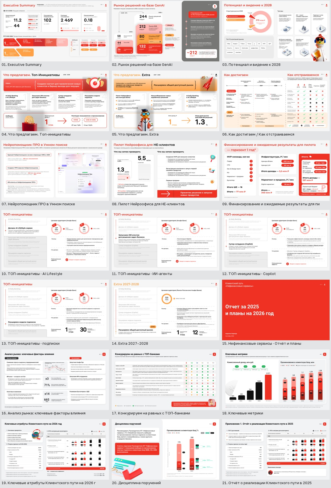

## Выбор композиции

Найди вопрос зрителя в таблице. Сверь поля двух близких страниц с материалом новой презентации. Открой превью и оригинал выбранной страницы. Переноси порядок чтения, акценты и компоновку. Числа, названия продуктов, выводы и периоды относятся к конкретному исходному проекту.

| Стр. | Какой вопрос решает слайд | Композиция |
| ---: | --- | --- |
| [01](#s01) | Что уже работает и какие направления должны дать рост? | Резюме стратегии на одном экране |
| [02](#s02) | Какая часть растущего рынка доступна продукту? | Два среза рынка и стратегический вывод |
| [03](#s03) | Каков масштаб рынка и какие силы меняют его устройство? | Структура рынка, игроки и тренды |
| [04](#s04) | Какие инициативы объединяет одна цель и чем будет измерен результат? | Видение, портфель и критерии успеха |
| [05](#s05) | Как отдельное направление расширяет доступный рынок? | Смежное направление и его экономика |
| [06](#s06) | Какие этапы приведут к выбранному положению среди конкурентов? | Дорожная карта рядом с конкурентной матрицей |
| [07](#s07) | Где пользователь увидит изменение и что оно даст? | Три изменения продукта рядом с интерфейсом |
| [08](#s08) | Какой потенциал проверяет пилот и какое решение надо принять после него? | Пилот, проверка и решение о запуске |
| [09](#s09) | Какие ресурсы нужны и к какому финансовому итогу ведёт модель? | Команда, расходы и итог пилота |
| [10](#s10) | Чьи задачи решит сервис и какими функциями? | Разбор инициативы через повседневные задачи |
| [11](#s11) | Как данные превращаются в конкретные сервисы для клиентов? | Разбор инициативы через данные и сервисы |
| [12](#s12) | Какие роли и сценарии должен покрыть новый помощник? | Разбор инициативы с несколькими сценариями |
| [13](#s13) | Как расширение подписки должно сказаться на доходе и числе пользователей? | Разбор инициативы с измеримым эффектом |
| [14](#s14) | Какой внешний сегмент доступен и что нужно сделать для выхода? | Разбор выхода за пределы текущей аудитории |
| [15](#s15) | Какой клиентский путь рассматривает отчёт и за какой период? | Обложка отчётного раздела |
| [16](#s16) | Какое наблюдение подтверждает фактор и чем отвечает команда? | Фактор рынка, свидетельство и действие |
| [17](#s17) | В каких сервисах есть различия между участниками рынка? | Конкурентный обзор с пояснением по каждой строке |
| [18](#s18) | Как меняется доход и за счёт каких сегментов растёт база? | Динамика дохода и состав клиентской базы |
| [19](#s19) | Какие задачи, ресурсы и метрики зафиксированы на год? | Паспорт годового плана с квартальным контролем |
| [20](#s20) | Что было поручено и чем подтверждено исполнение? | Исходное поручение и основание для закрытия |
| [21](#s21) | Что выполнено за период и как это подтвердил руководитель? | Отчёт о выполнении с заключением спонсора |

Число полей описывает исходный пример и помогает оценить объём новых данных. Число текстовых слоёв включает подписи и вспомогательные элементы. Пять соседних страниц 10–14 образуют одну серию. Первая показывает принцип, следующие меняют активную инициативу, состав аудитории, число строк и форму результата. В конце каждой карточки приведены существующие компоненты штатной галереи, на которые можно опираться при пересборке.

## Разбор исходных страниц

### 01. Резюме стратегии на одном экране

**Выбирать, когда нужно ответить на вопрос:** Что уже работает и какие направления должны дать рост?

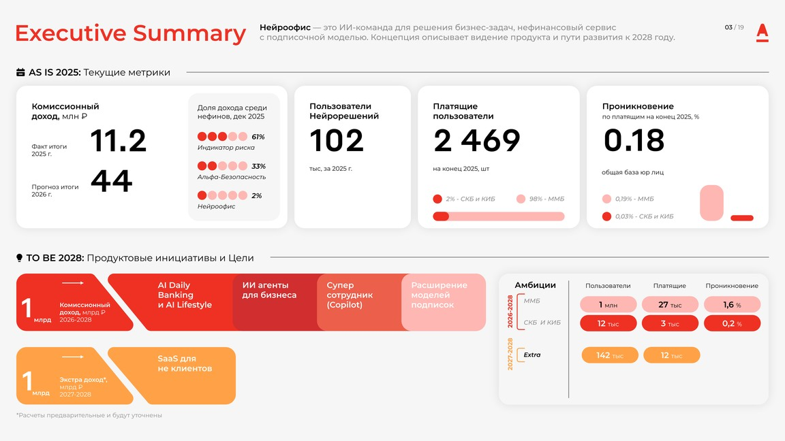

Сверху определение сервиса и блок текущих метрик. Внизу две ленты инициатив и цели по сегментам. Большие значения задают первый уровень чтения, периоды и базы расчёта стоят у своих величин.

**Поля исходной композиции.** Определение сервиса (1) · Карточки текущих показателей (4) · Внутренние направления в основной ленте (4) · Дополнительное направление (1) · Периоды целей (2).

**Роль графики.** Точки показывают доли, длина сегментированной ленты даёт порядок чтения. Строгого количественного значения ширине сегментов не задано.

**При замене данных.** Нужны фактические значения и однозначно подписанные прогнозы. Если остается только один тезис, резюме перегружает его.

**Источник.** Нейроофис, фрейм «3», исходная страница «Executive Summary», 60 видимых текстовых слоёв. [Figma 1:6425](https://www.figma.com/design/ciTiuNhnWFk5sQuTxQAV8Y/Untitled?node-id=1-6425) · [Полный слайд в PDF](originals.pdf#page=1)

**Близкие компоненты галереи.** [executiveSummary](../../components/gallery-textcore.js) · [kpiGrid](../../components/gallery-numbers.js)
[Исходный фрагмент 01](<components/Фрагменты/01.png>) · [Исходный фрагмент 02](<components/Фрагменты/02.png>) · [Исходный фрагмент 03](<components/Фрагменты/03.png>)

### 02. Два среза рынка и стратегический вывод

**Выбирать, когда нужно ответить на вопрос:** Какая часть растущего рынка доступна продукту?

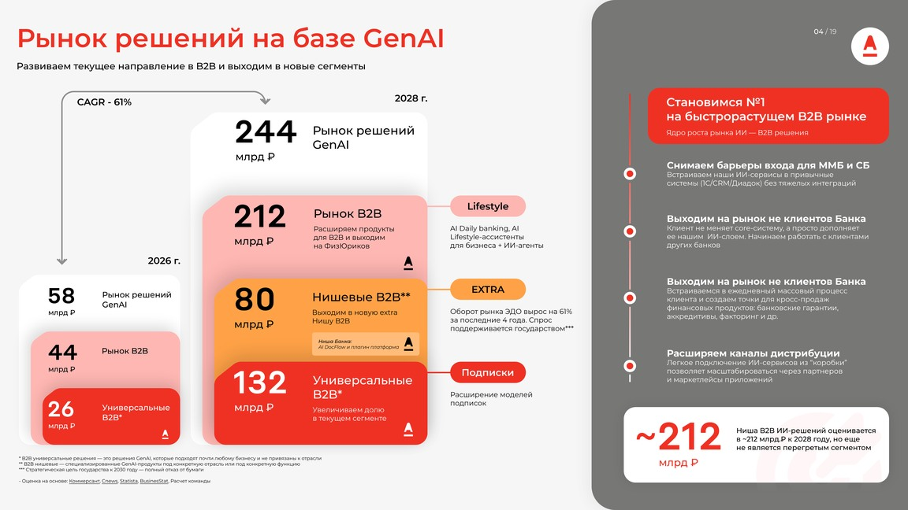

Слева оценка размера рынка в двух годах, в центре разбивка целевого рынка и пояснения по нишам. Правая тёмная колонка связывает вывод с четырьмя направлениями работы, внизу повторяется оценка выбранной ниши.

**Поля исходной композиции.** Срезы рынка по годам (2) · Категории будущего B2B-рынка (2) · Пояснения к направлениям продукта в центральной колонке (3) · Стратегические действия в правой колонке (4) · Итоговая оценка ниши (1).

**Роль графики.** Высота цветных полей передаёт различие величин. Переход между годами подписан темпом роста.

**При замене данных.** Не складывай общий рынок с входящими в него сегментами. Вынеси определения ниш и периоды расчёта в доступную сноску.

**Источник.** Нейроофис, фрейм «82895», исходная страница «Рынок решений на базе GenAI», 47 видимых текстовых слоёв. [Figma 1:6319](https://www.figma.com/design/ciTiuNhnWFk5sQuTxQAV8Y/Untitled?node-id=1-6319) · [Полный слайд в PDF](originals.pdf#page=2)

**Близкие компоненты галереи.** [marketTam](../../components/gallery-market.js) · [stackedColumns](../../components/gallery-market.js)
[Исходный фрагмент 04](<components/Фрагменты/04.png>)

### 03. Структура рынка, игроки и тренды

**Выбирать, когда нужно ответить на вопрос:** Каков масштаб рынка и какие силы меняют его устройство?

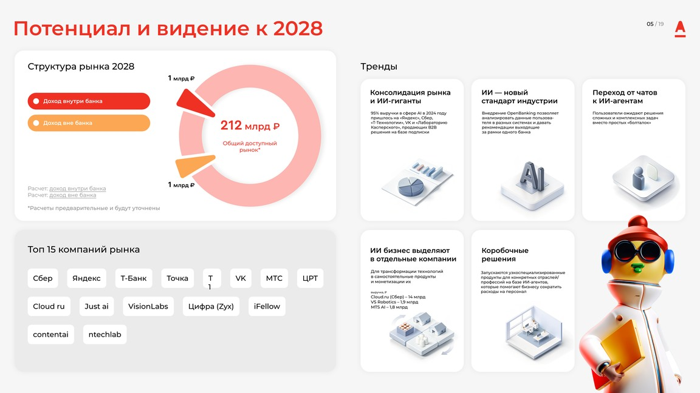

Левое поле разделено на структуру рынка и перечень игроков. Правое поле занимает набор трендов с предметными иллюстрациями. Кольцо показывает общий масштаб и выделенные фрагменты.

**Поля исходной композиции.** Оценка доступного рынка (1) · Оценки дохода внутри и вне банка (2) · Компании, заявленные в перечне (15) · Краткие описания трендов (5).

**Роль графики.** У каждого тренда своя небольшая иллюстрация. Персонаж размещён на свободном краю, за пределами основного текста.

**При замене данных.** Для нового рынка дай собственный перечень игроков и определения сегментов. Число позиций в исходной компоновке ограничено шириной левой части.

**Источник.** Нейроофис, фрейм «5», исходная страница «Потенциал и видение к 2028», 37 видимых текстовых слоёв. [Figma 1:6228](https://www.figma.com/design/ciTiuNhnWFk5sQuTxQAV8Y/Untitled?node-id=1-6228) · [Полный слайд в PDF](originals.pdf#page=3)

**Близкие компоненты галереи.** [marketTam](../../components/gallery-market.js) · [strategyPillars](../../components/gallery-strategy.js)
[Исходный фрагмент 05](<components/Фрагменты/05.png>)

### 04. Видение, портфель и критерии успеха

**Выбирать, когда нужно ответить на вопрос:** Какие инициативы объединяет одна цель и чем будет измерен результат?

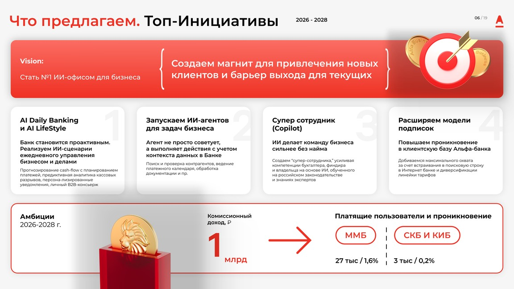

Верхняя полоса соединяет видение и формулировку пользы. В середине стоят четыре пронумерованные инициативы. Под ними общая строка амбиций связывает комиссионный доход с числом платящих клиентов и проникновением.

**Поля исходной композиции.** Видение и ценность (2) · Инициативы с названием, результатом и аргументом (4) · Цель по доходу (1) · Клиентские сегменты в целевой строке (2).

**Роль графики.** Мишень отмечает общую цель. Крупные бледные номера задают порядок внутри ряда, стрелка связывает разные показатели в нижней строке.

**При замене данных.** Нужно содержательное различие между четырьмя инициативами. При замене явно подпиши, как связаны показатели в нижней строке.

**Источник.** Нейроофис, фрейм «6», исходная страница «Что предлагаем. Топ-инициативы», 27 видимых текстовых слоёв. [Figma 1:6159](https://www.figma.com/design/ciTiuNhnWFk5sQuTxQAV8Y/Untitled?node-id=1-6159) · [Полный слайд в PDF](originals.pdf#page=4)

**Близкие компоненты галереи.** [strategyPillars](../../components/gallery-strategy.js) · [okrTree](../../components/gallery-strategy.js)
[Исходный фрагмент 06](<components/Фрагменты/06.png>)

### 05. Смежное направление и его экономика

**Выбирать, когда нужно ответить на вопрос:** Как отдельное направление расширяет доступный рынок?

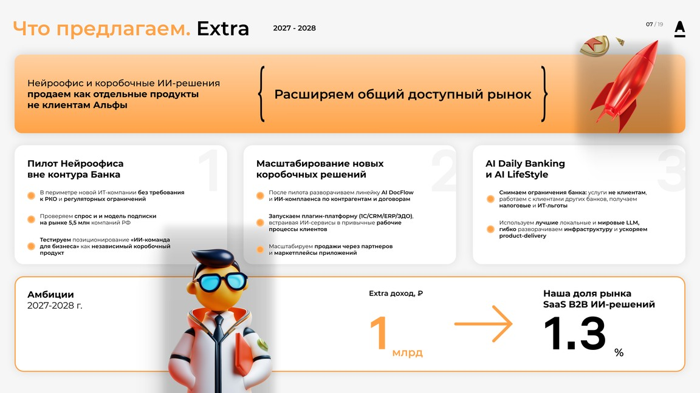

Тёплая верхняя полоса объединяет описание продукта и цель расширения. Под ней три инициативы. В нижней строке рядом стоят дополнительный доход и целевая доля рынка.

**Поля исходной композиции.** Описание продукта и цель (2) · Инициативы с коротким обоснованием (3) · Итоговые количественные цели (2) · Горизонт (1).

**Роль графики.** Оранжевая гамма отличает дополнительное направление от основного. Ракета и персонаж привязаны к портфелю и нижней строке.

**При замене данных.** Применяй как пару к основному портфелю или дай контекст самостоятельному слайду. У дохода и доли должны быть единицы и период.

**Источник.** Нейроофис, фрейм «7», исходная страница «Что предлагаем. Extra», 27 видимых текстовых слоёв. [Figma 1:6068](https://www.figma.com/design/ciTiuNhnWFk5sQuTxQAV8Y/Untitled?node-id=1-6068) · [Полный слайд в PDF](originals.pdf#page=5)

**Близкие компоненты галереи.** [strategyPillars](../../components/gallery-strategy.js) · [bigCompare](../../components/gallery-numbers.js)

### 06. Дорожная карта рядом с конкурентной матрицей

**Выбирать, когда нужно ответить на вопрос:** Какие этапы приведут к выбранному положению среди конкурентов?

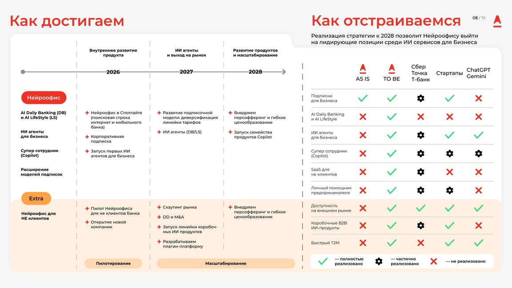

Левая половина содержит три годовых столбца и две группы рабочих направлений. Справа признаки продукта выстроены по строкам, варианты для сравнения по столбцам. Легенда объясняет статусы.

**Поля исходной композиции.** Годовые этапы (3) · Группы направлений (2) · Критерии сравнения (9) · Столбцы сравнения, включая текущее и целевое состояние (5) · Статусы в легенде (3).

**Роль графики.** Одна ось времени и независимая от неё матрица. Цвет и форма знака кодируют статус.

**При замене данных.** Разнеси панели на две страницы, если подписи критериев или названия этапов не читаются. Заполняй статусы из одинаково определённых источников.

**Источник.** Нейроофис, фрейм «8», исходная страница «Как достигаем / Как отстраиваемся», 51 видимых текстовых слоёв. [Figma 1:5849](https://www.figma.com/design/ciTiuNhnWFk5sQuTxQAV8Y/Untitled?node-id=1-5849) · [Полный слайд в PDF](originals.pdf#page=6)

**Близкие компоненты галереи.** [ganttLanes](../../components/gallery.js) · [featureDots](../../components/gallery-product.js)
[Исходный фрагмент 07](<components/Фрагменты/07.png>)

### 07. Три изменения продукта рядом с интерфейсом

**Выбирать, когда нужно ответить на вопрос:** Где пользователь увидит изменение и что оно даст?

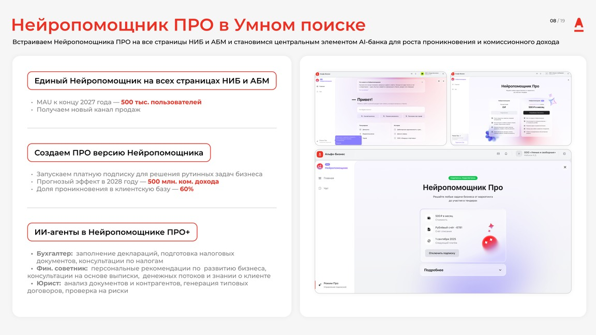

Слева три группы. Контуром выделено название каждого изменения, под ним пояснения. Справа два крупных фрагмента продукта рядом с конкретным описанием внедрения.

**Поля исходной композиции.** Общий тезис (1) · Группы изменений с пояснениями (3) · Иллюстрирующее поле с фрагментами интерфейса (1).

**Роль графики.** Снимки показывают реальный экран и его место в продукте. Важные числа акцентированы внутри пояснений.

**При замене данных.** Нужны читаемые экраны, которые действительно показывают описанное поведение. Подписи и идентификаторы на экране проверь для своей аудитории.

**Источник.** Нейроофис, фрейм «8.1», исходная страница «Нейропомощник ПРО в Умном поиске», 9 видимых текстовых слоёв. [Figma 1:5817](https://www.figma.com/design/ciTiuNhnWFk5sQuTxQAV8Y/Untitled?node-id=1-5817) · [Полный слайд в PDF](originals.pdf#page=7)

**Близкие компоненты галереи.** [screenCallouts](../../components/gallery-product.js) · [desktopShowcase](../../components/gallery-screens.js)
[Исходный фрагмент 08](<components/Фрагменты/08.png>)

### 08. Пилот, проверка и решение о запуске

**Выбирать, когда нужно ответить на вопрос:** Какой потенциал проверяет пилот и какое решение надо принять после него?

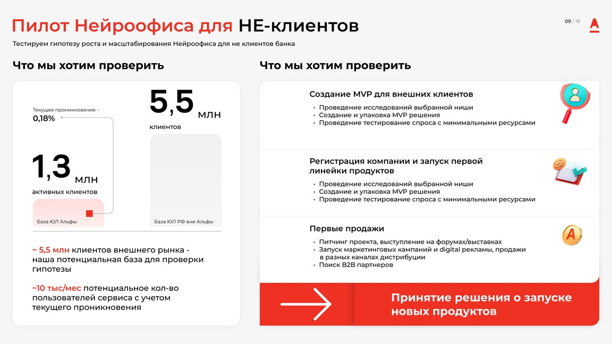

Слева сравниваются действующая и потенциальная клиентские базы, ниже поясняется логика привлечения. Справа сверху вниз даны три блока проверки. Нижняя красная полоса формулирует решение.

**Поля исходной композиции.** Сопоставленные клиентские базы (2) · Пояснения под сравнением (2) · Направления проверки (3) · Решение по итогам пилота (1).

**Роль графики.** Ширина информационных полей различается. Иллюстрации различают три проверки, крупная стрелка ведёт к формулировке решения.

**При замене данных.** Дай проверяемый результат каждой стадии. Размер потенциальной базы и фактические пользователи требуют разных подписей.

**Источник.** Нейроофис, фрейм «9», исходная страница «Пилот Нейроофиса для НЕ-клиентов», 25 видимых текстовых слоёв. [Figma 1:5755](https://www.figma.com/design/ciTiuNhnWFk5sQuTxQAV8Y/Untitled?node-id=1-5755) · [Полный слайд в PDF](originals.pdf#page=8)

**Близкие компоненты галереи.** [phaseGate](../../components/gallery-progress.js) · [askStatement](../../components/gallery-textops.js)

### 09. Команда, расходы и итог пилота

**Выбирать, когда нужно ответить на вопрос:** Какие ресурсы нужны и к какому финансовому итогу ведёт модель?

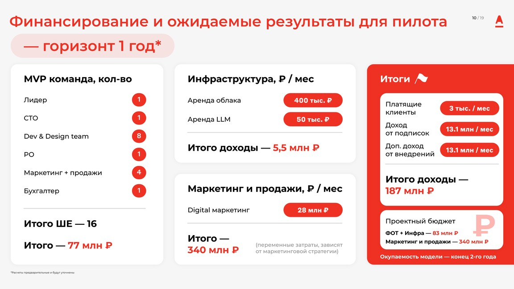

Левый столбец раскрывает состав команды и сумму затрат. Средний столбец разделён на инфраструктуру и продвижение. Правая контрастная полоса сводит доходы, бюджет и срок окупаемости.

**Поля исходной композиции.** Роли в команде (6) · Статьи инфраструктуры (2) · Статьи продвижения (1) · Показатели в верхнем блоке итогов (3) · Проектный бюджет и срок окупаемости (2).

**Роль графики.** Табличные пары выравнивают статью и значение. Правая полоса визуально отделяет итоговую модель от исходных данных.

**При замене данных.** При замене пересчитай все итоги и явно разведи месячные и годовые величины. Условие предварительной оценки остаётся рядом с моделью.

**Источник.** Нейроофис, фрейм «10», исходная страница «Финансирование и ожидаемые результаты для пилота», 43 видимых текстовых слоёв. [Figma 1:5662](https://www.figma.com/design/ciTiuNhnWFk5sQuTxQAV8Y/Untitled?node-id=1-5662) · [Полный слайд в PDF](originals.pdf#page=9)

**Близкие компоненты галереи.** [askFunds](../../components/gallery-numbers.js) · [revenueFormula](../../components/gallery-market.js)

### 10. Разбор инициативы через повседневные задачи

**Выбирать, когда нужно ответить на вопрос:** Чьи задачи решит сервис и какими функциями?

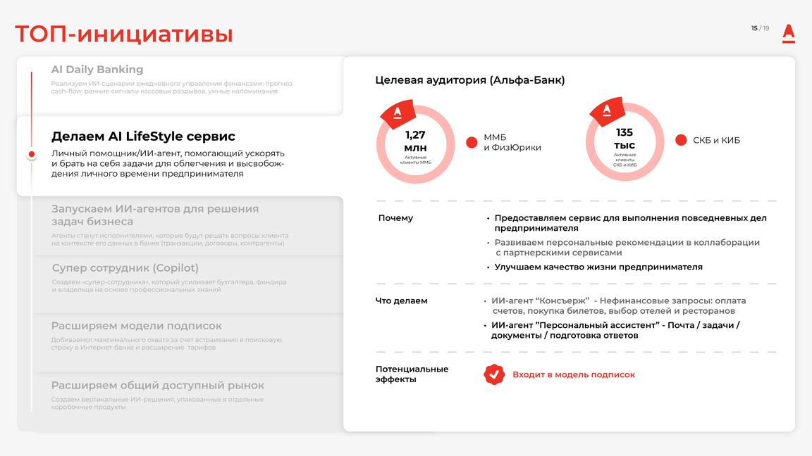

Слева неизменный список из шести инициатив. Активная строка занимает позицию 2. Справа сверху показана аудитория, ниже последовательно идут обоснование, действия и эффект.

**Поля исходной композиции.** Позиции в списке (6) · Числа аудитории (2) · Обоснования (3) · Действия или решения (2) · Эффекты (1).

**Роль графики.** Два кольца представляют размеры клиентских сегментов. Внизу один короткий статус показывает связь с подписочной моделью.

**При замене данных.** Используй для продуктовой инициативы, где результат объясняется через задачи клиента. Отдельно проверь основания чисел аудитории.

**Источник.** Нейроофис, фрейм «15», исходная страница «ТОП-инициативы · AI Lifestyle», 30 видимых текстовых слоёв. [Figma 1:5442](https://www.figma.com/design/ciTiuNhnWFk5sQuTxQAV8Y/Untitled?node-id=1-5442) · [Полный слайд в PDF](originals.pdf#page=10)

**Близкие компоненты галереи.** [methodNotes](../../components/gallery-textops.js) · [nextStepsText](../../components/gallery-textops.js)
[Исходный фрагмент 09](<components/Фрагменты/09.png>)

### 11. Разбор инициативы через данные и сервисы

**Выбирать, когда нужно ответить на вопрос:** Как данные превращаются в конкретные сервисы для клиентов?

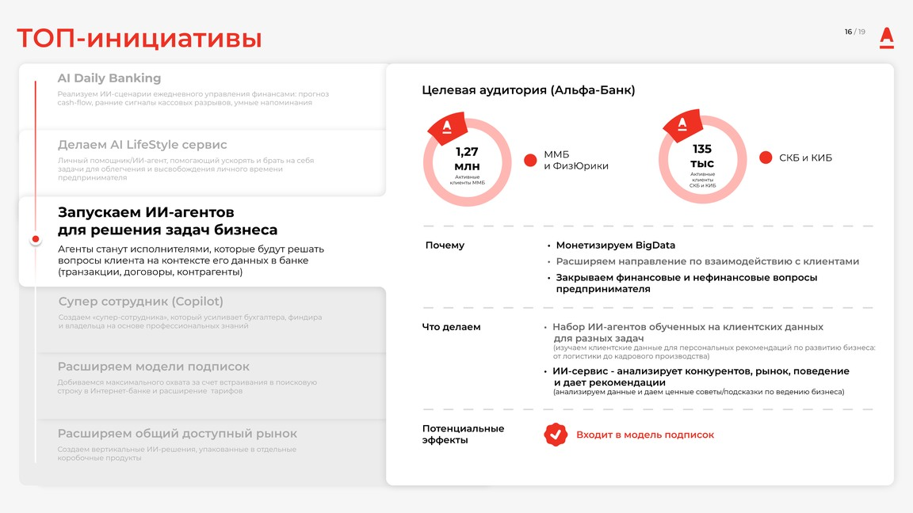

Слева неизменный список из шести инициатив. Активная строка занимает позицию 3. Справа сверху показана аудитория, ниже последовательно идут обоснование, действия и эффект.

**Поля исходной композиции.** Позиции в списке (6) · Числа аудитории (2) · Обоснования (3) · Действия или решения (2) · Эффекты (1).

**Роль графики.** Два сегмента аудитории остаются на прежнем месте. Действия раскрыты названиями решений и примерами их применения.

**При замене данных.** Параллельные страницы предполагают общую структуру сегментов. Связь с моделью подписки переноси только при подтверждении.

**Источник.** Нейроофис, фрейм «16», исходная страница «ТОП-инициативы · ИИ-агенты», 30 видимых текстовых слоёв. [Figma 1:5360](https://www.figma.com/design/ciTiuNhnWFk5sQuTxQAV8Y/Untitled?node-id=1-5360) · [Полный слайд в PDF](originals.pdf#page=11)

**Близкие компоненты галереи.** [methodNotes](../../components/gallery-textops.js) · [nextStepsText](../../components/gallery-textops.js)
[Исходный фрагмент 09](<components/Фрагменты/09.png>)

### 12. Разбор инициативы с несколькими сценариями

**Выбирать, когда нужно ответить на вопрос:** Какие роли и сценарии должен покрыть новый помощник?

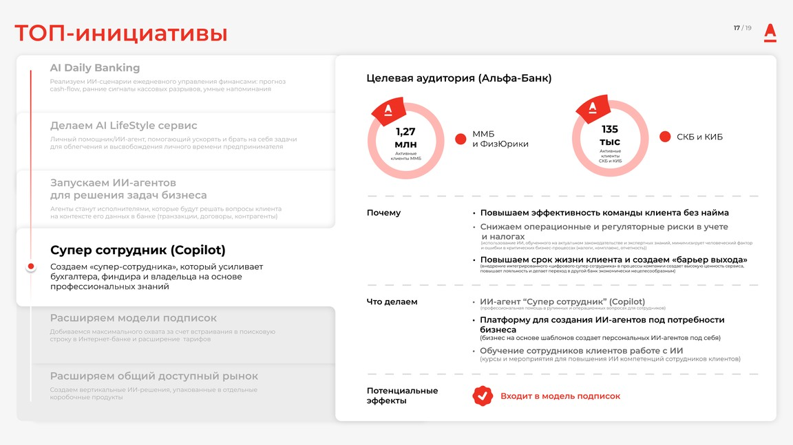

Слева неизменный список из шести инициатив. Активная строка занимает позицию 4. Справа сверху показана аудитория, ниже последовательно идут обоснование, действия и эффект.

**Поля исходной композиции.** Позиции в списке (6) · Числа аудитории (2) · Обоснования (3) · Действия или решения (3) · Эффекты (1).

**Роль графики.** Аудитория сохраняет тот же масштаб, дополнительное место отдано третьему действию.

**При замене данных.** Проверь, что заголовки сценариев различимы без длинных пояснений. Если каждому нужна собственная история, разведи её по страницам.

**Источник.** Нейроофис, фрейм «17», исходная страница «ТОП-инициативы · Copilot», 31 видимых текстовых слоёв. [Figma 1:5277](https://www.figma.com/design/ciTiuNhnWFk5sQuTxQAV8Y/Untitled?node-id=1-5277) · [Полный слайд в PDF](originals.pdf#page=12)

**Близкие компоненты галереи.** [methodNotes](../../components/gallery-textops.js) · [nextStepsText](../../components/gallery-textops.js)
[Исходный фрагмент 09](<components/Фрагменты/09.png>)

### 13. Разбор инициативы с измеримым эффектом

**Выбирать, когда нужно ответить на вопрос:** Как расширение подписки должно сказаться на доходе и числе пользователей?

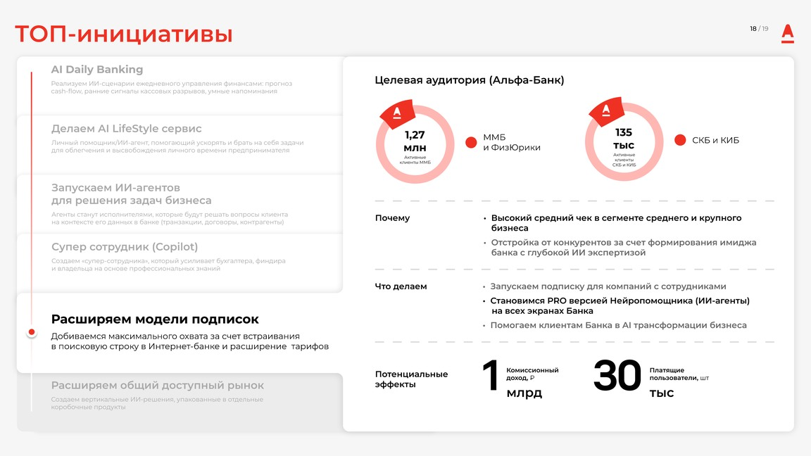

Слева неизменный список из шести инициатив. Активная строка занимает позицию 5. Справа сверху показана аудитория, ниже последовательно идут обоснование, действия и эффект.

**Поля исходной композиции.** Позиции в списке (6) · Числа аудитории (2) · Обоснования (2) · Действия или решения (3) · Эффекты (2).

**Роль графики.** Два крупных числа в нижней зоне заменяют короткий статус предыдущих страниц. Каждое число снабжено собственной единицей.

**При замене данных.** Наличие двух разных эффектов здесь определяет композицию. Если эффект один, не заводи второе число ради симметрии.

**Источник.** Нейроофис, фрейм «18», исходная страница «ТОП-инициативы · подписки», 35 видимых текстовых слоёв. [Figma 1:5190](https://www.figma.com/design/ciTiuNhnWFk5sQuTxQAV8Y/Untitled?node-id=1-5190) · [Полный слайд в PDF](originals.pdf#page=13)

**Близкие компоненты галереи.** [methodNotes](../../components/gallery-textops.js) · [kpiList](../../components/gallery.js)
[Исходный фрагмент 09](<components/Фрагменты/09.png>)

### 14. Разбор выхода за пределы текущей аудитории

**Выбирать, когда нужно ответить на вопрос:** Какой внешний сегмент доступен и что нужно сделать для выхода?

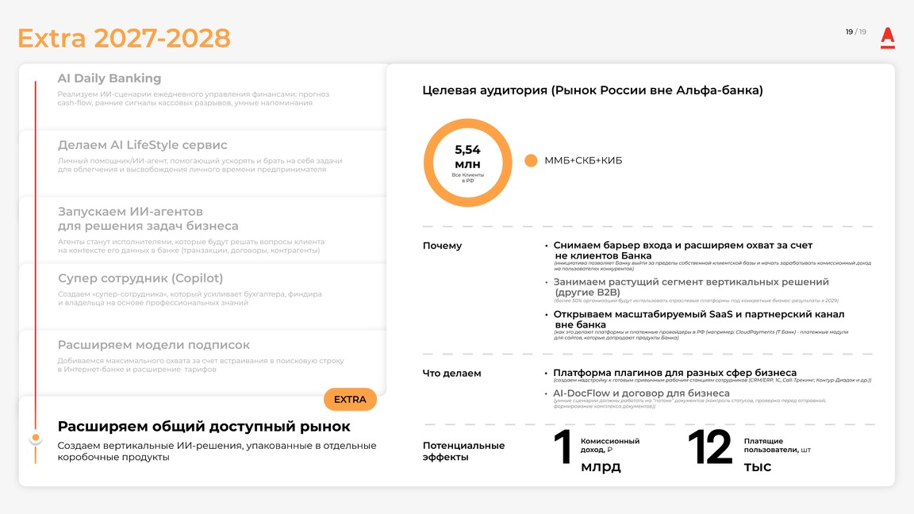

Слева неизменный список из шести инициатив. Активная строка занимает позицию 6. Справа сверху показана аудитория, ниже последовательно идут обоснование, действия и эффект.

**Поля исходной композиции.** Позиции в списке (6) · Числа аудитории (1) · Обоснования (3) · Действия или решения (2) · Эффекты (2).

**Роль графики.** Вместо пары колец показан один внешний сегмент. Оранжевая метка и тон заголовка связывают страницу с дополнительным направлением.

**При замене данных.** Цифра внешнего рынка нуждается в самостоятельном источнике. Не подставляй базу действующих клиентов вместо размера доступной аудитории.

**Источник.** Нейроофис, фрейм «19», исходная страница «Extra 2027–2028», 33 видимых текстовых слоёв. [Figma 1:5112](https://www.figma.com/design/ciTiuNhnWFk5sQuTxQAV8Y/Untitled?node-id=1-5112) · [Полный слайд в PDF](originals.pdf#page=14)

**Близкие компоненты галереи.** [methodNotes](../../components/gallery-textops.js) · [kpiList](../../components/gallery.js)
[Исходный фрагмент 09](<components/Фрагменты/09.png>)

### 15. Обложка отчётного раздела

**Выбирать, когда нужно ответить на вопрос:** Какой клиентский путь рассматривает отчёт и за какой период?

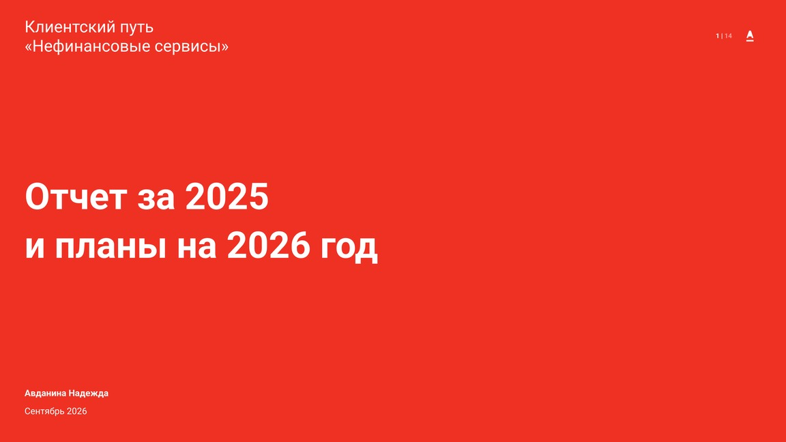

На красном поле сверху слева стоит название клиентского пути. Крупное название отчёта занимает среднюю часть. Два коротких поля у нижнего левого края сообщают автора и дату.

**Поля исходной композиции.** Название клиентского пути (1) · Тема и периоды отчёта (1) · Автор (1) · Дата (1).

**Роль графики.** Работают цвет поля, масштаб букв и расстояние между тремя текстовыми зонами.

**При замене данных.** Подходит для открытия самостоятельного раздела. Предусмотри короткую текстовую формулировку: длинное описание занимает место темы.

**Источник.** КРБ 2026, фрейм «82987», исходная страница «Нефинансовые сервисы · Отчёт и планы», 5 видимых текстовых слоёв. [Figma 15:5072](https://www.figma.com/design/ciTiuNhnWFk5sQuTxQAV8Y/Untitled?node-id=15-5072) · [Полный слайд в PDF](originals.pdf#page=15)

**Близкие компоненты галереи.** [sectionDivider](../../components/gallery-textcore.js) · [cover](../../templates/deck-starter/slides.js)

### 16. Фактор рынка, свидетельство и действие

**Выбирать, когда нужно ответить на вопрос:** Какое наблюдение подтверждает фактор и чем отвечает команда?

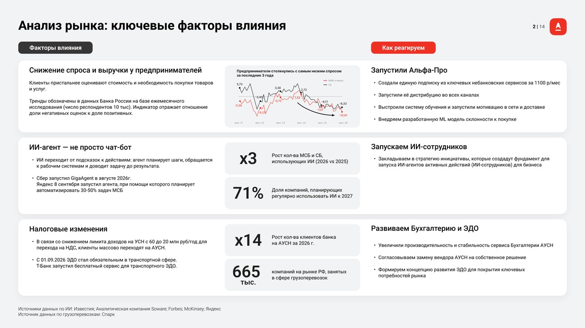

Три поперечные полосы читаются слева направо. Слева фактор, в центре график или пара чисел, справа ответ команды. Источники вынесены вниз.

**Поля исходной композиции.** Факторы (3) · Ответные действия по строкам (3) · Доказательства в центральной колонке (3) · График в первой строке (1) · Пары чисел во второй и третьей строках (2).

**Роль графики.** Разный вид доказательства подчинён общей горизонтали. Цвет заголовка отмечает колонку реакции.

**При замене данных.** Сохрани соответствие один к одному между фактором и ответом. Если источник не подтверждает наблюдение, заменяй данные или сам вывод.

**Источник.** КРБ 2026, фрейм «82986», исходная страница «Анализ рынка: ключевые факторы влияния», 46 видимых текстовых слоёв. [Figma 15:4961](https://www.figma.com/design/ciTiuNhnWFk5sQuTxQAV8Y/Untitled?node-id=15-4961) · [Полный слайд в PDF](originals.pdf#page=16)

**Близкие компоненты галереи.** [causeEffect](../../components/gallery-exchange.js) · [executiveSummary](../../components/gallery-textcore.js)
[Исходный фрагмент 10](<components/Фрагменты/10.png>) · [Исходный фрагмент 11](<components/Фрагменты/11.png>)

### 17. Конкурентный обзор с пояснением по каждой строке

**Выбирать, когда нужно ответить на вопрос:** В каких сервисах есть различия между участниками рынка?

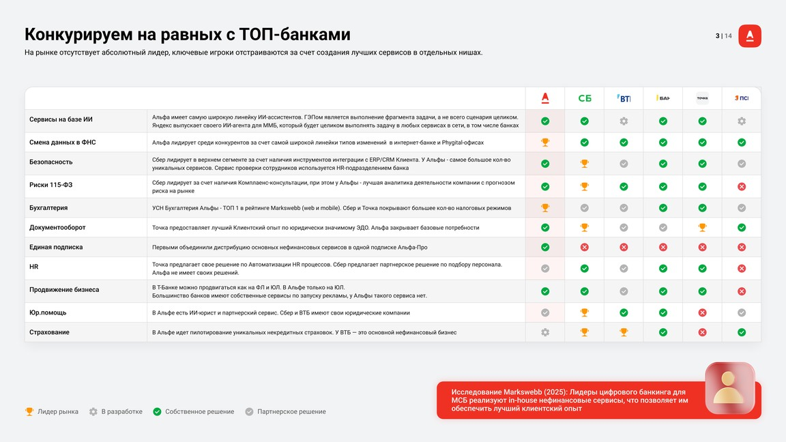

Критерий и пояснение занимают левую часть каждой строки. Справа единая матрица статусов по шести участникам. Под таблицей разделены легенда и вывод исследования.

**Поля исходной композиции.** Сервисы или критерии (11) · Пояснения по строкам (11) · Сравниваемые участники (6) · Обозначения в легенде (4) · Вывод с атрибуцией (1).

**Роль графики.** Логотипы обозначают колонки, цветные значки сообщают тип решения. Один столбец выделен на всю высоту для сравнения.

**При замене данных.** Определи одно правило оценки для всей матрицы, дай источники. При сравнении по меньшему числу признаков используй более крупную таблицу.

**Источник.** КРБ 2026, фрейм «82985», исходная страница «Конкурируем на равных с ТОП-банками», 30 видимых текстовых слоёв. [Figma 15:4620](https://www.figma.com/design/ciTiuNhnWFk5sQuTxQAV8Y/Untitled?node-id=15-4620) · [Полный слайд в PDF](originals.pdf#page=17)

**Близкие компоненты галереи.** [featureDots](../../components/gallery-product.js) · [comparison](../../components/gallery.js)

### 18. Динамика дохода и состав клиентской базы

**Выбирать, когда нужно ответить на вопрос:** Как меняется доход и за счёт каких сегментов растёт база?

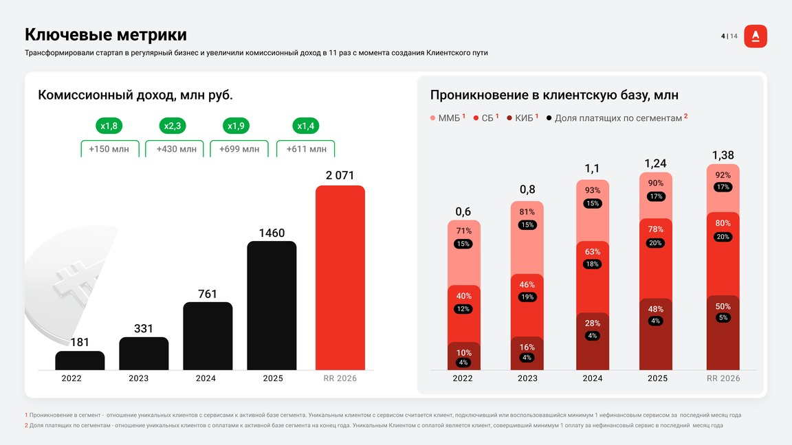

Два графика одного временного горизонта занимают равные поля. Слева отдельные столбцы дохода, между соседними периодами подписан прирост. Справа состав базы разбит на сегменты.

**Поля исходной композиции.** Периоды в каждой серии (5) · Значения дохода (5) · Изменения между периодами (4) · Клиентские сегменты в составе базы (3) · Общее число клиентов по периоду (5).

**Роль графики.** Чёрный и красный различают историю и текущую оценку в левом графике. В правом оттенки обозначают сегменты; подписи поясняют доли.

**При замене данных.** У графиков разные единицы. Сохрани отдельные заголовки и обозначения. Перед выводом проверь итоги, доли и статус последнего периода.

**Источник.** КРБ 2026, фрейм «82984», исходная страница «Ключевые метрики», 74 видимых текстовых слоёв. [Figma 15:4453](https://www.figma.com/design/ciTiuNhnWFk5sQuTxQAV8Y/Untitled?node-id=15-4453) · [Полный слайд в PDF](originals.pdf#page=18)

**Близкие компоненты галереи.** [barsTrend](../../components/gallery.js) · [stackedColumns](../../components/gallery-market.js)

### 19. Паспорт годового плана с квартальным контролем

**Выбирать, когда нужно ответить на вопрос:** Какие задачи, ресурсы и метрики зафиксированы на год?

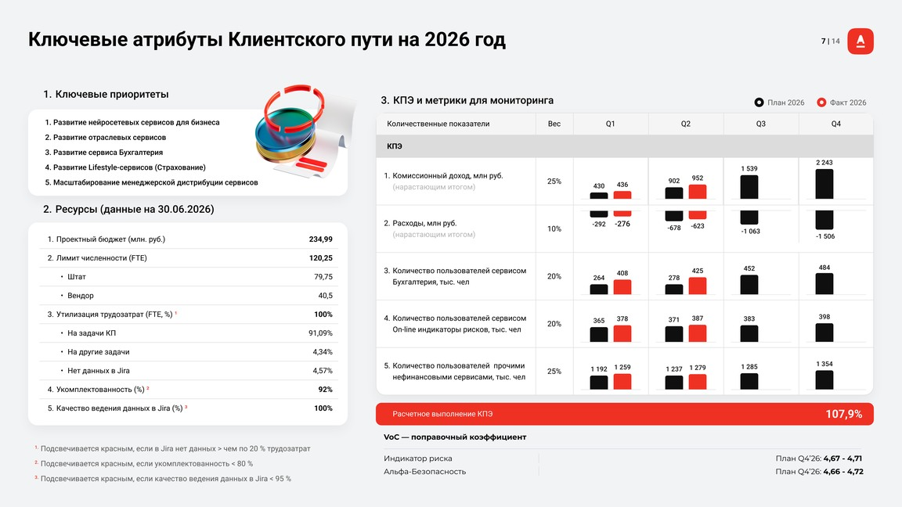

Левая колонка соединяет приоритеты и таблицу ресурсов. Правая раскрывает взвешенные КПЭ по кварталам. Красная строка завершает расчёт, ниже показаны дополнительные контрольные величины.

**Поля исходной композиции.** Ключевые приоритеты (5) · Блок ресурсов с датой (1) · КПЭ с весами (5) · Квартальные колонки (4) · Итог и дополнительные контрольные показатели (3).

**Роль графики.** Короткие парные столбцы помещены прямо в клетки таблицы; цвет связан с легендой план / факт.

**При замене данных.** Не рисуй факт для будущего квартала. Сохраняй вес у своей строки, дату ресурсов и единую методику расчёта итогового показателя.

**Источник.** КРБ 2026, фрейм «82982», исходная страница «Ключевые атрибуты Клиентского пути на 2026 год», 85 видимых текстовых слоёв. [Figma 15:4001](https://www.figma.com/design/ciTiuNhnWFk5sQuTxQAV8Y/Untitled?node-id=15-4001) · [Полный слайд в PDF](originals.pdf#page=19)

**Близкие компоненты галереи.** [tableEditorial](../../components/gallery.js) · [pairedColumns](../../components/gallery-progress.js)
[Исходный фрагмент 12](<components/Фрагменты/12.png>) · [Исходный фрагмент 13](<components/Фрагменты/13.png>)

### 20. Исходное поручение и основание для закрытия

**Выбирать, когда нужно ответить на вопрос:** Что было поручено и чем подтверждено исполнение?

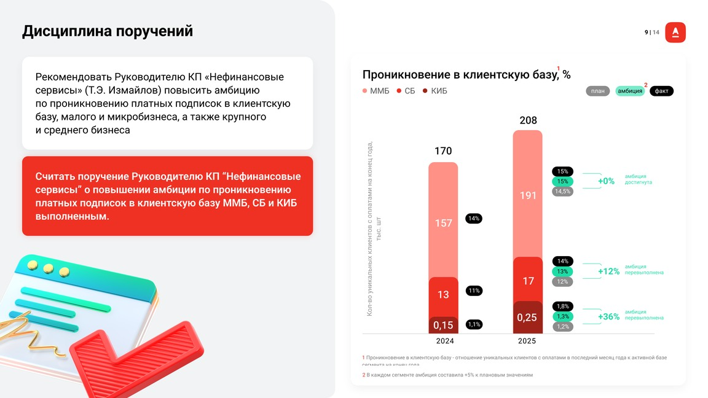

Слева дословная постановка поручения и вывод об исполнении. Справа график динамики клиентской базы с данными по сегментам, сравниваемыми со значениями плана и амбиции.

**Поля исходной композиции.** Формулировка поручения (1) · Решение об исполнении (1) · Сравниваемые годы (2) · Клиентские сегменты (3) · Статусы сравнения: план, амбиция, факт (3).

**Роль графики.** Изображение с галочкой сопровождает принятое решение. Проверка обеспечена числами в правой половине.

**При замене данных.** Сохрани в тексте поручения адресата и критерий исполнения. Раскрой различие между планом и амбицией в сноске.

**Источник.** КРБ 2026, фрейм «82980», исходная страница «Дисциплина поручений», 44 видимых текстовых слоёв. [Figma 15:3631](https://www.figma.com/design/ciTiuNhnWFk5sQuTxQAV8Y/Untitled?node-id=15-3631) · [Полный слайд в PDF](originals.pdf#page=20)

**Близкие компоненты галереи.** [askStatement](../../components/gallery-textops.js) · [stackedColumns](../../components/gallery-market.js)

### 21. Отчёт о выполнении с заключением спонсора

**Выбирать, когда нужно ответить на вопрос:** Что выполнено за период и как это подтвердил руководитель?

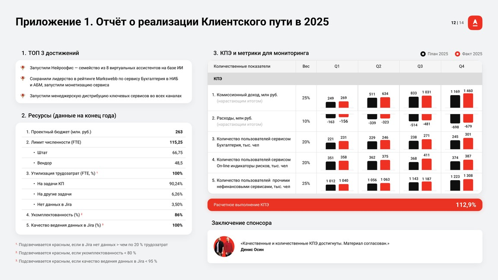

Левая половина объединяет достижения и итоговые ресурсы. Справа квартальная таблица показывает исполнение КПЭ, ниже расположены итоговая строка и заключение спонсора.

**Поля исходной композиции.** Достижения (3) · Блок ресурсов на конец года (1) · КПЭ с весами (5) · Квартальные колонки (4) · Итоговая величина (1) · Заключение спонсора с авторством (1).

**Роль графики.** Пиктограммы отмечают достижения. Соседние столбцы внутри каждой ячейки позволяют сравнить план с фактом.

**При замене данных.** Для переноса нужны проверенные квартальные данные, методика взвешивания и согласованная формулировка заключения с авторством.

**Источник.** КРБ 2026, фрейм «82977», исходная страница «Отчёт о реализации Клиентского пути в 2025», 94 видимых текстовых слоёв. [Figma 15:3233](https://www.figma.com/design/ciTiuNhnWFk5sQuTxQAV8Y/Untitled?node-id=15-3233) · [Полный слайд в PDF](originals.pdf#page=21)

**Близкие компоненты галереи.** [tableEditorial](../../components/gallery.js) · [weeklyHighlights](../../components/gallery-progress.js)
[Исходный фрагмент 12](<components/Фрагменты/12.png>) · [Исходный фрагмент 13](<components/Фрагменты/13.png>) · [Исходный фрагмент 14](<components/Фрагменты/14.png>)

## Проверка оригиналов

Повторный импорт выделенного FIG-файла в OpenPencil сохранил две исходные секции, все 21 фрейм и служебный мастер логотипа. Для каждого из 21 фреймов сравнили повторный рендер с рендером полного исходного файла в разрешении 3840 × 2160. Все RGB-пиксели совпали. PDF содержит те же страницы с текстовым слоем поиска. Для правок исходных эффектов и шрифтов используй Figma-файл; часть сложных объектов в PowerPoint сохранена изображениями. Для кодирования сравнения и навигации по продуктам используй данные своего проекта.
